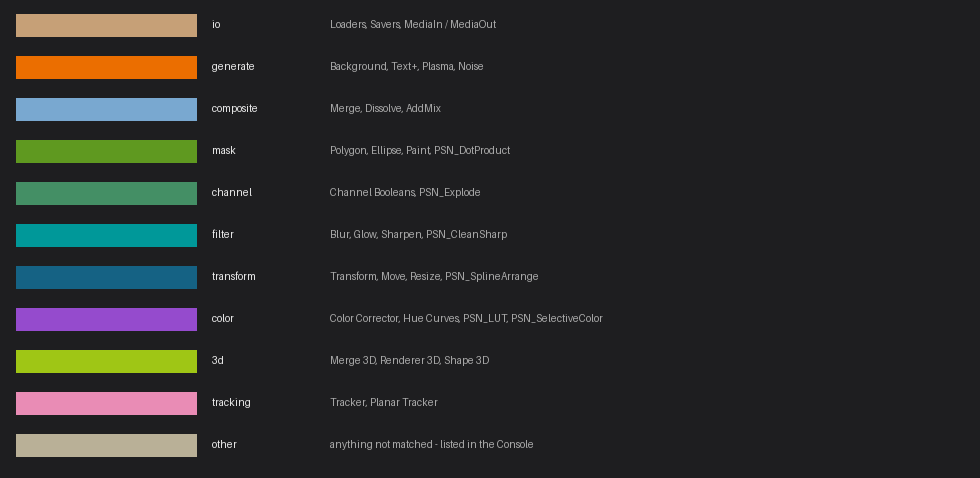

# Scripts

Companion Fusion scripts — **not** fuses. A `.lua` here is a comp script: it runs from
Fusion's `Script` menu (or a hotkey) and builds/wires nodes, instead of registering a new
tool the way a `.fuse` does.

Install path mirrors the folder tree: `Scripts/Comp/` → `%APPDATA%\Blackmagic Design\Fusion\Scripts\Comp\`.
Restart is not needed; Fusion picks comp scripts up when the menu is opened.

| File | Menu entry | What it does |
|---|---|---|
| `Comp/Null.lua` | `Scripts → Comp → Null` | Inserts the small square `Null` (PipeRouter) after the selected node, painted yellow and spliced into the chain (`selected → Null → what followed`). Bound to a hotkey via `View → Customize Hotkeys`; `Ctrl+Alt+N` is the one used here. |
| `Comp/PSN_ColorNodes.lua` | `Scripts → Comp → PSN_ColorNodes` | Colours node tiles by category — the whole comp when nothing is selected, the selection otherwise. Meant to be run once per project from a hotkey. |

Why a script: Fusion draws every fuse as its standard long tile, so the compact square
marker can only be a PipeRouter — and a PipeRouter is inserted, not registered.

## PSN_ColorNodes

Fusion gives a node exactly one colour (the strip under the tile) and snaps it to a fixed
palette, so there is no per-node tile fill to set. The script paints that strip by category:

- Nothing selected colours every node in the comp; a selection colours only those nodes, so it
  can be re-run on new parts of a flow without touching hand-painted nodes.
- One undo step, named `Colour nodes by category`.
- `Note`, `Underlay` and `GroupOperator` are left alone — they are annotations, not image ops.
- Nodes the rules do not recognise get beige and are listed in the Console, so the keyword
  table at the top of the script can be extended.
- `PAL`, `PSN` and `RULES` at the top of the file are the whole configuration; the colours are
  exact entries of Fusion's tile palette, so nothing is snapped to a neighbouring swatch.
